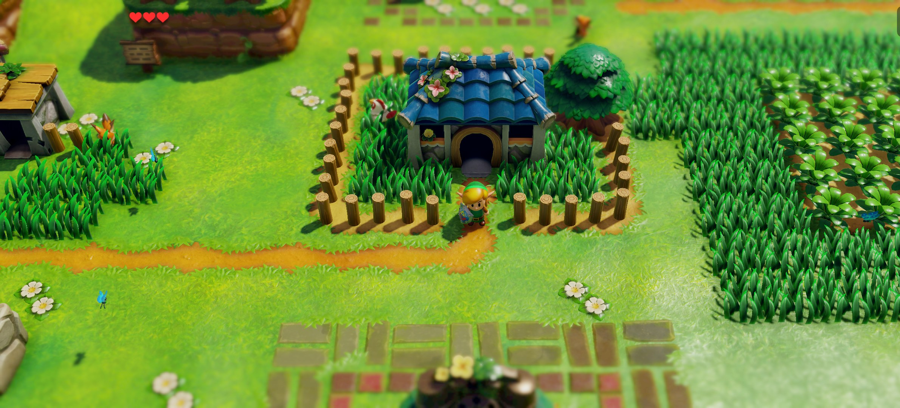
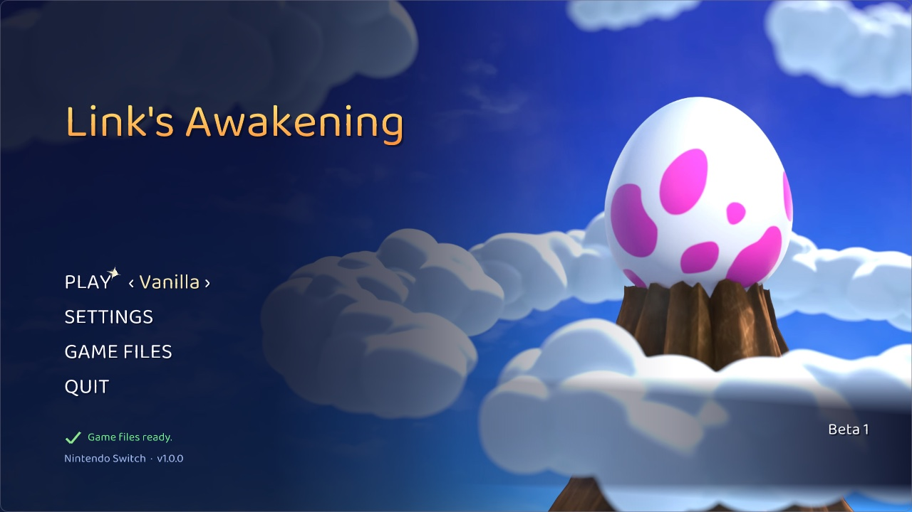

# LAS Recomp

> [!IMPORTANT]
> **This project was made almost exclusively with AI.** Nearly all of the code, tooling, reverse engineering and
> documentation in this repository was written by and will be maintained by an AI (Anthropic's Claude, through Claude Code),
> directed, tested and reviewed by a human. As a huge fan of this game, I made this for myself. Sharing it is a courtesy.
> If you don't agree with the use of AI or don't trust code written by AI, that is your right, but I'm not interested
> in the controversy in relation to this project. You may simply ignore this project and its code.
> As with anything on the internet, you run the code at your own discretion.

**LAS Recomp** is a static recompilation of *The Legend of Zelda: Link's Awakening* (Nintendo Switch, 2019) into a
native Windows and macOS application.

> [!NOTE]
> Currently supported platforms:
> - macOS - Apple Silicon only, Metal graphics backend + MetalFX
> - Windows - x86-64 only, Vulkan graphics backend

> [!NOTE]
> **No game files are included.** LAS Recomp needs your own legally obtained copy of the game: a dump of
> *Link's Awakening* **v1.0.0** (XCI or NSP) from your console and your console's `prod.keys`.
> Instructions on how to obtain these files from your Switch and game copy will **NOT** be provided.
> On first launch the start screen extracts what it needs. No game files, assets, keys or fonts are included.
> The screenshot shows the start screen after extraction; no Nintendo artwork is included until provided by the user.

## Project Discord
https://discord.gg/DhrgdYqdcY

## Status

This is a 0.1 alpha release. That means bugs are likely, crashes could occur, randomizer seeds could possibly be unsolvable (dungeon room shuffle modes are especially experimental at this point) and some graphics issues remain (especially in wide and ultrawide aspect ratios). This is a work in progress, hence the alpha designation. Please use the Discord for discussing possible randomizer logic issues and submitting bug reports.

## Features

**Runs natively**
- **This is not emulation.** Runs natively on Windows and macOS using static recompilation of the Switch code.
- Unlocked aspect ratio: wider (or taller) windows show more of the island, up to ultrawide; houses and dungeons
  keep their framing. The original 16:9 framing is one option away.
- Start screen: play vanilla or any randomizer seed, set up game files from your own dump, import fonts.
  - Switch games use fonts built into the Switch operating system for some text. Sensible replacements are used by default, but you may optionally set up the Switch fonts for an authentic look. Switch fonts are Nintendo IP; you must provide them from your own hardware.
- In-game overlay menu (F1, or Minus + Plus on a controller).
- Switch between vanilla and any randomizer seed without restarting the app.
- Keyboard and controller support, with every button and key remappable (Controls tab / start screen Settings >
  Controls; menus keep a fixed layout, so a remap can never lock you out).
- Button prompts for your controller: Xbox or PlayStation icons in the game's own UI and text when SDL reports
  that controller (or pick Nintendo / Xbox / PlayStation yourself); the icons follow your controller remapping.
- Optional 360-degree movement, blur removal and a hidden Hero Mode icon.
- Apple MetalFX upscaler on macOS (the default there).
- Internal resolution adjustments: raise or lower the resolution in steps, match the display, or use dynamic resolution. Combined with the MetalFX upscaler, even a MacBook Air should handle this easily with the right settings. Bilinear upscaling is the only option on Windows currently.

**Randomizer**
- In-game seed generator.
- Seed IDs for sharing or reproducing exact seeds.
- Per-seed save games.
- Full item shuffle.
- Trade Quest shuffle.
- Disable Acorn / Piece of Power drops.
- Bombs / Magic Powder shuffle.
- Hookshot anything - the hookshot latches onto any wall or object, not just hookshot targets (in logic where enabled).
- Environment Randomizer - randomizes in-game environmental effects.
- Music Randomizer.
- Escape Bottle - every seed gives you this gold bottle from the start (it replaces one bottle in the pool). Use it to
  warp to the dungeon entrance when in a dungeon, or to Marin and Tarin's house anywhere else. Never required by the logic.
- Pickup text in the game's own message box: dungeon items name the dungeon they belong to ("You got a small key for
  Tail Cave!").
- Potsanity - every pot is a check. Pots are golden until checked, so you can see at a glance which pots you've checked.
- Bushsanity - every cuttable bush (not the grass) is a check. Like pots, bushes are golden until checked for the first
  time. Bushes over a hole or staircase stay normal, so items can't fall in.
- Digsanity - a truly insane setting that makes every diggable tile on the overworld a check (about 5,000). Holes stay
  dug permanently so you know where you've dug. Made for shovel enthusiasts.
- Keysanity - keys can be found anywhere for any dungeon.
- Shopsanity - the shop's 6 items are checks, at vanilla or random prices, or just steal them. A bought or stolen slot
  shows a sold-out sign.
- Trendsanity - full Trendy Game randomization: every prize, including the figures, is a check.
- Pets - companions as items in the pool:
  - Rooster - in logic for Feather checks (including in dungeons if companions are allowed there).
  - Marin - you need to find Marin to get into the desert; choosing open desert removes Marin from the item pool.
  - Ghost - find the Ghost to unlock his grave check.
  - Switch companions from the pause menu, or send yours away.
- Boss souls - a boss doesn't appear, can't be beaten and its reward stays locked until you find its soul.
- Mini-boss souls - the same for dungeon mini-bosses (a separate option).
- Entrance Randomizer - shuffles dungeon entrances, houses and caves, and connector caves. Includes a decoupled option.
- Dungeon Room Shuffler - shuffles all dungeon rooms, creating unique custom dungeons every seed. Three modes:
  - Coherent: dungeon rooms are shuffled but connecting rooms are lined up. To keep this workable in logic, dungeons
    sometimes use duplicate rooms (as few as possible).
  - Chaos: dungeon rooms are shuffled but don't need to make sense. Walking north may lead you to a door from another
    direction.
  - Madness: dungeon rooms are shuffled in a way that doesn't need to make sense AND the doors are decoupled, creating
    nightmares to navigate.
  - Labyrinth (planned): an option for all dungeon room shuffles where doors in dungeons can lead into other dungeons,
    essentially making one giant dungeon with numerous wings.
  - Optionally the map shows what's connected to what as you explore, or in full once you find the dungeon's map.
- The inventory screen tracks keys, dungeon items, trade items and souls for each dungeon, so you can see at a glance
  what you have keys for and which trade items you still hold.
- Built-in check tracker on the overworld map (optional).

## Building from source

Requirements (macOS on Apple Silicon): Xcode command line tools (clang), [Homebrew](https://brew.sh) `sdl3` and
`ffmpeg`, Python 3.12.

1. Put your game files in place: `mkdir extracted` in the checkout, build (step 3) and use the start screen's
   game-file setup, or extract your v1.0.0 dump yourself into `extracted/` (`exefs/`, `romfs/` and `romfs.bin`)
   with [hactool](https://github.com/SciresM/hactool) (`make hactool` builds it).
2. Recompile the game code: `make gen` (writes `generated/`, from your own `extracted/exefs`).
3. Build: `make -j10` -> `build/lasrecomp`.
4. Randomizer: create the Python environment for LAS-Randomizer in `third_party/LAS-Randomizer/venv`:
   `python3.12 -m venv venv && venv/bin/pip install -r requirements.txt`. Release builds instead ship the seed
   generator as a standalone helper, so players need no Python: `make rando-helper` (after `make deps`, or with
   `brew install keystone` for this Mac only) -> `build/helper/rando-gen/`.
5. Run: `./build/lasrecomp extracted` (start screen) or `./build/lasrecomp extracted --play` (straight into the game).
6. Package: `make deps` (once: SDL3, FFmpeg, hactool, keystone and Python from pinned sources, built for macOS 15),
   `make rando-helper`, then `make app` -> `build/LAS Recomp.app` (macOS 15+, Apple Silicon);
   `make dist` -> `build/dist/LAS Recomp-<version>-windows.zip` (Windows, see [docs/BUILD-windows.md](docs/BUILD-windows.md)).

Where files live (game files, saves, seeds, settings, caches, imported fonts):
- macOS app: `~/Library/Application Support/com.peiikai.lasrecomp/` (the app itself is never written to).
- Windows: next to `lasrecomp.exe`, so put the `LAS Recomp` folder somewhere writable (not Program Files).
- Dev / portable mode: if the folder you start from has `extracted/` (a source checkout), that folder is used, as above.
- `LARECOMP_DATA_ROOT=<dir>` overrides all of these.

## Credits

**LAS-Randomizer** - the randomizer at the heart of this project's randomizer features, vendored (with local
changes) in `third_party/LAS-Randomizer` under the MIT license. Huge thanks to its authors and community:
- **Owen_Splat** - LAS-Randomizer (https://github.com/Owen-Splat/LAS-Randomizer)
- **Glan** - created the original early builds of the randomizer (https://github.com/la-switch/LAS-Randomizer)
- **ProfessorLaw** - additional programming
- and everyone who has reported bugs, given feedback or contributed to LAS-Randomizer

**Community mods** - some options re-implement ideas from these GameBanana mods (re-implemented in the recomp;
none of their files are used):
- **360 Controls (And More!)** by Owen_Splat - 360-degree movement, blur removal (blur removal patch by theboy181)
  (https://gamebanana.com/mods/659802)
- **XBOX UI** by fellow_demo - Xbox button prompts (https://gamebanana.com/mods/540069)
- **PS4 UI Buttons** by messiahgov - PlayStation button prompts (https://gamebanana.com/mods/324458)
- **No Hero Mode Indicator** by Boo/Calla - hide the Hero Mode icon (https://gamebanana.com/mods/441172)

**Libraries and tools**
- [SDL 3](https://libsdl.org) - windowing, input, audio (zlib license)
- [FFmpeg](https://ffmpeg.org) - movie playback (LGPL)
- [Dear ImGui](https://github.com/ocornut/imgui) - overlay menu and start screen (MIT)
- [Vulkan Memory Allocator](https://github.com/GPUOpen-LibrariesAndSDKs/VulkanMemoryAllocator) - Windows renderer (MIT)
- [hactool](https://github.com/SciresM/hactool) by SciresM - game file extraction (ISC)
- [oead](https://github.com/zeldamods/oead) and [evfl](https://github.com/zeldamods/evfl) - Nintendo file formats, used by LAS-Randomizer
- [PyInstaller](https://pyinstaller.org) - packs the seed generator into a standalone helper (GPL 2.0+ with the
  bootloader exception, which allows distributing the packed program). The helper bundles CPython (PSF License),
  oead / evfl (GPL 2.0+), [Keystone](https://www.keystone-engine.org) (GPL 2.0; Python bindings BSD), quicktex
  (LGPL 3), Pillow (MIT-CMU), PyYAML (MIT) and appdirs (MIT)
- [Capstone](https://www.capstone-engine.org) - disassembly in the development tools
- [envytools](https://github.com/envytools/envytools) - NVIDIA GPU documentation used for the shader translator
- The Switch homebrew community's documentation ([Switchbrew](https://switchbrew.org))

## Legal

LAS Recomp is a fan project. It is not affiliated with, endorsed by or sponsored by Nintendo. *The Legend of Zelda*
and *Link's Awakening* are trademarks of Nintendo. No game files, assets, keys or fonts are included - not in this
repository and not in release builds. You must provide your own legally obtained copy of the game (and your own keys)
to play.

## License

LAS Recomp's own code (the recompiler tools, the runtime, the randomizer additions) is open source under the
[MIT License](LICENSE). Third-party components keep their own licenses: LAS-Randomizer (MIT), Dear ImGui (MIT),
Vulkan Memory Allocator (MIT), SDL 3 (zlib), FFmpeg (LGPL 2.1+, linked dynamically), hactool (ISC), and the seed generator
helper's bundled libraries listed under Credits (oead / evfl / Keystone are GPL 2.0+: the helper is a separate program
the game runs, and its sources are this repository plus those projects' published sources). The license covers LAS Recomp's code only - it grants
nothing for Nintendo's game, which you must supply yourself.
